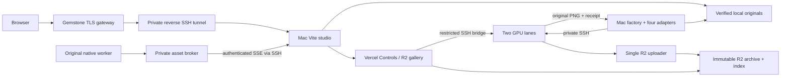

# Redeploying the artwork studio

This directory contains source and configuration for the running application architecture: the original resident FLUX worker, its private HTTP facades, model download recipes and revision pins, the original asset broker, R2 uploader, image judges, Mac factory/adapters/refiller, launchd templates, and Vercel API. It complements the frontend, local-first gallery, native event bridge, lifecycle collector, task inbox, Enforcer, and Performance daemon already in the repository root.

This is a source bundle, not a backup. It contains no weights, images, queues, job journals, request ledgers, logs, virtual environments, downloaded wheels, binaries, credentials, or SSH private keys. Checkpoint manifests describe pinned upstream files without containing checkpoint bytes. The synthetic migration renderer was deliberately excluded. Validation never generates images.

## Source layout and service topology

| Location | Purpose |
| --- | --- |
| `worker/native/source/` | Byte-for-byte original `~/FLUX` Python worker and its two local modules; hashes retained in `native/source.json`. |
| `worker/native_launch.py`, `native.py` | Timing wrapper and journaled bridge to the original Unix worker. The receipt wrapper includes the deployed completed-model provenance fallback. |
| `worker/worker.py` | Serialized private FLUX.1 and FLUX.2 HTTP APIs on loopback ports 18761/18762. |
| `worker/download.py`, `models/pins.json` | Exact FLUX snapshot revisions, selected files and verified expected sizes. |
| `worker/piper_local.py` | Author's original in-memory Unix asset broker, restoring `asset.publish` announcements without restarting the model. Durable storage remains the factory and R2. |
| `worker/r2/` | Independent immutable image/receipt uploader and conditional study-index writer; one active writer. |
| `worker/judges/`, `worker/download-judges.py` | Pixtral, DINOv2 and Gemma source, runtime pins, model download recipes, observer middleware and private loopback services. |
| `supervisor/`, `supervisor-scripts/` | Captured application service definitions/wrappers. Platform Caddy/portal/driver services are not replaced. |
| `controller/`, `launchd/` | Mac queue, current completion-event adapter, bounded scene refiller, ingress source and sanitized service templates. See `controller/README.md`. |
| `api/` | Existing authenticated Controls and public R2 gallery API source; Vercel-only API deployment configuration. |
| `../server/`, `../scripts/`, `../serve.py` | Current local-first studio and its daemons. Corrections/Winners no longer import code from a sibling repository. |

The two-card topology uses GPU 0 for native FLUX.1 and the judge services; GPU 1 runs FLUX.2 with a Transformers FP8 text encoder and BF16 diffusion transformer. Jay authorized the encoder upgrade and FLUX.2 continuous output at 1024×1024 on 2026-10-17; FLUX.1 remains 512×512. The study default remains 28 steps and 3.5 guidance with the existing seed policy. Two cards are independent lanes; their VRAM is not combined.

The FP8 encoder uses optimized compressed-tensors modules, disables KV caching, and preserves the 512-token conditioning limit. Text-only pruning retains 31 of 40 decoder layers and removes the unused vision tower, projector and vocabulary head. Startup compares full and pruned conditioning bitwise on an existing queued prompt before accepting work. An ordinary queued 1024×1024 image completed after cutover; no extra validation image was generated. The historical `flux2-dev-nf4` profile ID remains stable for queue compatibility. Setting `ARTWORK_FLUX2_ENCODER=nf4` in the installed wrapper restores the retained NF4 checkpoint when the lane is safely idle.



## Validate without deployment

From a checkout with Python 3.11+, Bash, and Node 22.12+:

```sh
python3 -B deployment/deploy.py check
npm ci
npm run build
```

The check parses captured Python/JSON/plists/Supervisor configuration, checks shell syntax, verifies original native hashes and the bundle inventory, and rejects obvious credentials or runtime assets. Package locks normalize the four CUDA wheels previously installed from temporary local files into their exact published versions. The manifest records these deployment transformations. No weights are downloaded and no services or inference jobs are started by `check`.

## Prepare a replacement GPU host

Use a compatible Vast Linux base image with two sufficiently large Blackwell GPUs, a compatible injected NVIDIA driver, `/venv/main/bin/python`, `uv`, Supervisor, and the standard `/opt/supervisor-scripts/utils/logging.sh` helper used by the judge wrappers. Read `/etc/vast-agents-guide.md`. Confirm `/workspace` is backed by the intended persistent volume. Size storage for the approximately 114 GB selected FLUX weights, judge snapshots, installed environments, generated work and download headroom. Driver installation and GPU power changes are not part of this deployment.

Clone/copy this repository to the new host using separately provisioned Git access. Keep existing production submissions held while replacing a host. Preserve factory IDs, originals, native journals and Controls request ledgers separately; never manufacture an empty queue as a substitute for recovering accepted work.

On the replacement:

```sh
python3 -B deployment/deploy.py check
python3 -B deployment/deploy.py install --control-public-key /private/artwork-control.pub
python3 -B deployment/deploy.py dependencies --judges
```

`install` refuses to replace source while any existing artwork service is running. It stages application files at the fixed `/workspace/artwork` paths expected by the actual worker code, copies service wrappers, and installs all captured application programs **stopped**. It preserves unrelated SSH authorizations and can add only a restricted Ed25519 public key for the Controls bridge. `dependencies` recreates isolated pinned inference, downloader, R2 and optional judge environments; the base inference environment must not be shared with vLLM. These commands are implemented but have not been executed against a second empty instance during this source capture.

The actual CUDA/PyTorch download CDN was slow during the migration. `UV_HTTP_TIMEOUT=600`, retries and persistent package caching are set by the dependency installer. The exact package pins remain unchanged; all credentials are supplied separately.

## Provision private files and download pinned models

Provide these files through private channels, outside this Git tree:

- `/workspace/artwork/hf/token`, mode 0600, containing the authorized Hugging Face token with access to the gated model repositories.
- `/workspace/artwork/r2/credentials.json`, mode 0600, using the keys in `r2-credentials.example.json` and existing scoped bucket access.
- On the Mac: the retained Controls token and restricted SSH private key, mode 0600, plus verified host-key entries. Never copy an old server's private SSH host keys.
- The preserved Controls `control/requests/` ledger, native journal and accepted job records when recovering an existing deployment. Queue state and images are separate private migration data, not source.

Start only the required download programs after private HF access exists:

```sh
supervisorctl start artwork-download
supervisorctl start artwork-encoder-fp8-download
supervisorctl start artwork-judges-download artwork-gemma4-download
```

The judges command is optional when judges are not being deployed. The recipes download the pinned checkpoints and validate their size/hash/header rules. The FLUX downloader writes the completion `models/manifest.json`; committed `models/pins.json` is only a source specification and must never be substituted for that completion evidence. The FP8 downloader separately verifies all six weight shards against pinned sizes and SHA-256 hashes before writing `models/flux2-fp8/.download-complete.json`. Wait for both completion records before starting FLUX.2. Model downloads do not need a copied model volume.

Do not run `artwork-judges-install` after the pinned `dependencies --judges` operation; its captured historical recipe is retained for architectural provenance, while the pinned installer is the redeploy path. Qwen has a separate explicitly requested TP2 prompt-drafting service; it is not automatically enabled by judge installation. Its integrated MTP checkpoint is restored from private R2 as described below.

## Start workers, archive and judges

After downloads and private state reconciliation:

```sh
python3 /workspace/artwork/second-flux1-gpu1/prepare.py
supervisorctl start artwork-piper artwork-native-flux1 artwork-native-flux1-gpu1
# Wait for /workspace/artwork/native/flux1.sock and the native model-ready message.
supervisorctl start artwork-flux1 artwork-flux1-gpu1
# Keep artwork-flux2 stopped while the second FLUX1 lane occupies GPU1.
curl --fail http://127.0.0.1:18761/health
curl --fail http://127.0.0.1:18762/health
supervisorctl start artwork-r2
# Optional, after all judge snapshots and runtime-ready marker exist:
supervisorctl start artwork-dino artwork-pixtral artwork-gemma
# After the separately verified R2 restore and a memory check:
# /workspace/artwork/r2/.venv/bin/python /workspace/artwork/judges/download_qwen_r2.py
# supervisorctl start artwork-qwen
```

Check actual readiness, GPU assignment, private loopback binding, and ordinary generation through the existing authorized queue. Verify a real original locally and in R2 against its receipt SHA-256; no synthetic/proof image is needed. Keep exactly one uploader for the existing study prefix and retain its historical index. Do not restart healthy resident workers to validate frontend changes.

The captured `artwork-readiness` program is an alternative startup coordinator, not an additional inference worker. All staged Supervisor programs have autostart disabled by the installer so start order is explicit. Once the intended persistent services have passed ordinary-work verification, set their installed autostart policy as appropriate for the operator's host lifecycle. Never autostart old synthetic validation programs.

Native `update` semantics apply to atlas batches. Ordinary single-image renders retain their submitted steps/guidance; the authenticated native bridge rejects claims that these can be changed during an existing image. Live state, original asset events, local-first delivery and independent R2 archival remain available without that unsupported mutation.

## Reconnect the existing API and Mac studio

Verify the replacement's SSH host key through a trusted provider channel. The Vercel pin is the hexadecimal SHA-256 of the decoded Ed25519 public-key blob, not the OpenSSH display fingerprint. Keep the existing Controls token/key and install the matching restricted public key on the new worker host.

Fill a mode-0600 private env file using `api.env.example`, outside the checkout. The API host is a hostname without `root@`; the Mac adapter host convention includes `root@`. Configure/redeploy only the existing API project through an already authenticated Vercel CLI:

```sh
python3 -B deployment/configure_api.py /private/artwork-api.env --check
python3 -B deployment/configure_api.py /private/artwork-api.env --deploy
```

Values are passed to Vercel over stdin and are never printed. No Vercel API token is bundled. Frontend hosting stays on the Mac through the TLS gateway/tunnel; the API deploy does not move DNS or replace that route. Gemstone itself and its private account/domain configuration remain operator infrastructure; the captured ingress manager and `ingress/` Caddy snippets document the required forwarding boundary. The gateway terminates public TLS/SNI and forwards this domain to Caddy loopback port 8443; its reverse tunnel listens at 48630 and reaches the Mac at 48624. Private certificates and the global Gemstone routing configuration are not copied.

Configure `.runtime/service-env.json` from `studio-service-env.example.json`. Use one consistent `ARTWORK_FACTORY_STATE` for the studio and every factory/refiller service. Existing private state may remain outside the checkout; source is now bundled under `deployment/controller`. On a clean deployment, place state beneath its ignored `.state` directory or set an explicit private state location. Never copy a live SQLite database without a consistent backup.

Render the sanitized launchd templates with absolute paths and the current authorized coordinator thread, then follow `controller/README.md`. Start the studio/tunnel, the four model-specific adapters, and the bounded refiller last. Current agent lifecycle observation depends on the user's own local Codex state/session installation. The captured legacy observer is opt-in historical source and is not the current Enforcer.

Confirm unauthenticated Controls are rejected, the retained authorized session reaches the new host, both models report truthful state, ordinary images appear in Stream from local originals before archive completion, and R2 continues independently. A configured plist or API deployment is not evidence that these paths are live.

## Qwen prompt drafting and direct chat

Qwen is an additional explicitly requested service, not a replacement for FLUX or a juror. Its launcher is `scripts/judges/start_qwen.sh` (deployment copy under `deployment/worker/judges/`); supervisor configuration is `deployment/worker/judges/artwork-qwen.conf`. The pinned R2 restore tool is `scripts/judges/download_qwen_r2.py`. It restores RadixArk/Qwen3.8-27B-NVFP4 revision319f741cce68d7914884900c138a1fbb70a42f30 onto the persistent volume and verifies content hashes, shard indexes and integratedMTP tensors without inference. Supply R2 credentials privately at the documented runtime path; none are committed.

The verified live configuration uses vLLM0.31.0, TP2 on GPUs0/1, integrated MTP3, BF16 compute with the checkpoint's mixedNVFP4/FP8 weights, text-only mode, context4096, seq1, explicit768MiB KV perGPU and512token prefill. FlashInfer autotuning is disabled because its larger warmup profile required excessive workspace on the busyGPU0. GPU0 headroom was approximately5GiB after initialization; do not assume identical room on another machine. Preserve both FLUX workers and existing jurors. No clock or driver changes are part of deployment.

Loopback8005 serves `qwen-precision`; Pixtral remains loopback8002 `pixtral-critic`. The Vite app reaches both through authenticated local SSH text-only proxies. Chat does not execute code, modify prompts or enable juror crosstalk. The prompt revision runner is separate, with assistant baseline hashes and independent semantic approval before the paired production compiler can select new wording.
